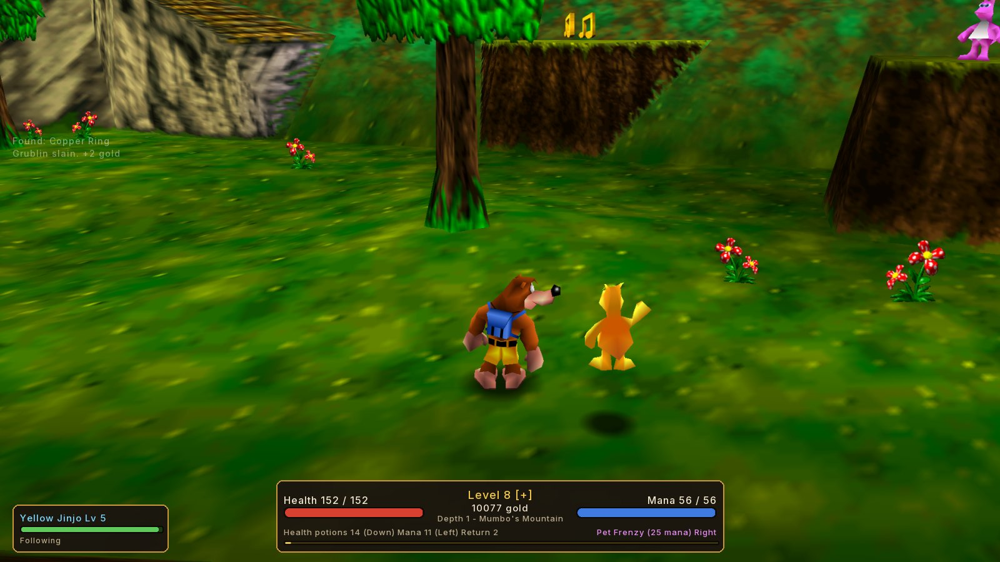
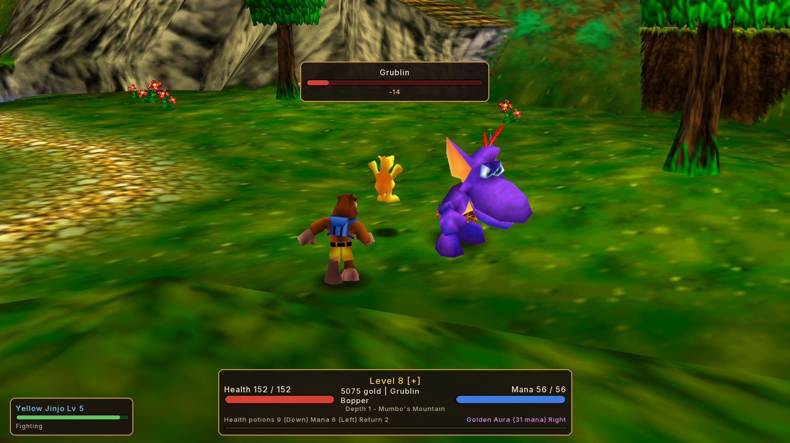
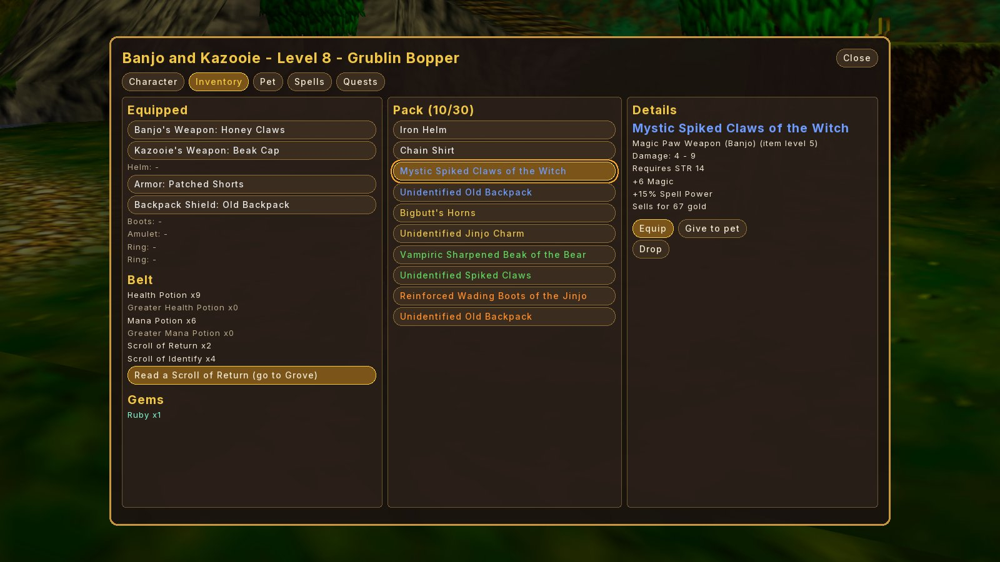
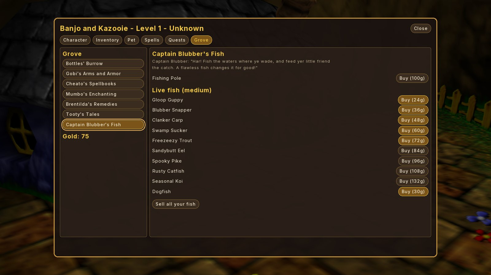
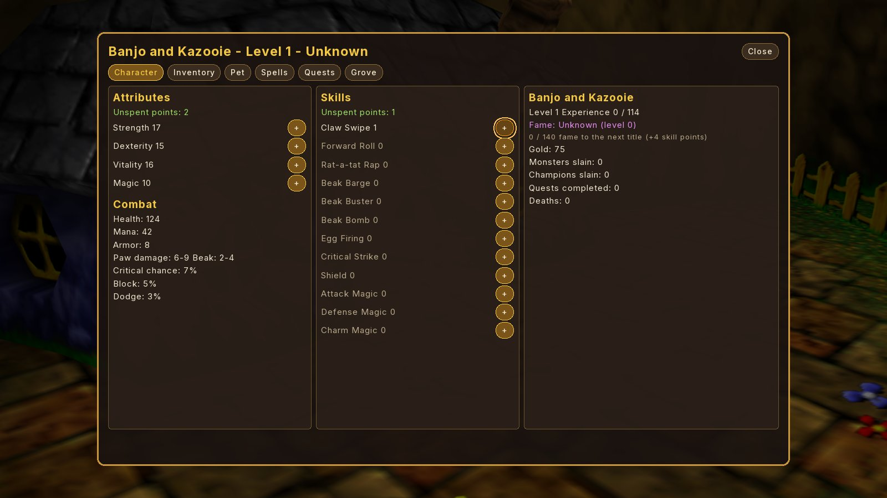
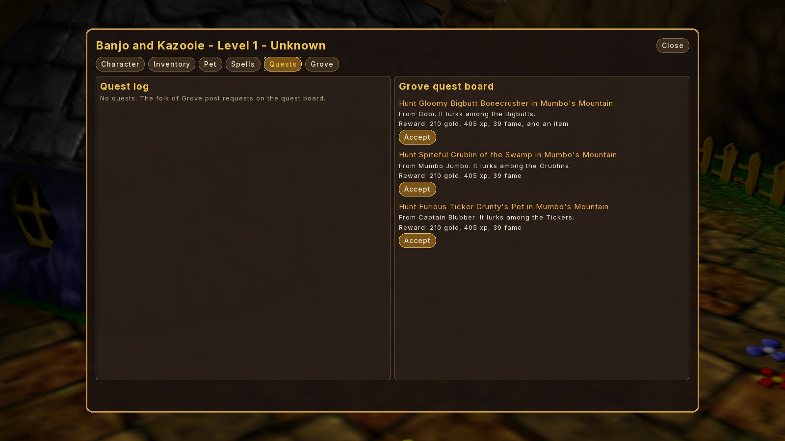

# Banjo-Kazooie: Fate Edition

A mod for **[Banjo-Kazooie: Recompiled](https://github.com/BanjoRecomp/BanjoRecomp)** (the native PC
port) that turns the game into **WildTangent's _Fate_** (2005): a loot-driven action RPG. Banjo,
Kazooie and everyone else stay themselves; the rules around them become Fate's.

Built against the [Banjo-Kazooie decompilation](https://gitlab.com/banjo.decomp/banjo-kazooie)
using the official [BKRecompModTemplate](https://github.com/BanjoRecomp/BKRecompModTemplate).

| | |
|---|---|
|  |  |
|  |  |
|  |  |

## Install

1. Copy `dist/bk_fate_edition.nrm` into Banjo: Recompiled's `mods` folder (open it from the
   in-game **Mods** menu).
2. Enable **Banjo-Kazooie: Fate Edition** in the Mods menu and start the game.
3. Start a new game file. Your Fate saves live in their own save file, separate from your
   normal Banjo-Kazooie saves.

Settings (Mods menu → the mod's gear icon): difficulty, pet species (Jinjo / Bigbutt calf / none),
champion monsters on/off, Gruntilda's bargain on/off, HUD on/off.

## Controls

The mod only uses buttons Banjo: Recompiled leaves free for mods.

| Action | Controller | Keyboard (default) |
|---|---|---|
| Open the Fate menu (pauses the world) | D-Pad Up | I |
| Quaff a health potion | D-Pad Down | K |
| Quaff a mana potion | D-Pad Left | J |
| Cast the selected spell | D-Pad Right | L |
| Fish while wading in water / otherwise cycle spells | L | E |

Menus work with the controller (D-Pad/stick to move, A to press) or the mouse.

## What Fate features are in it

| Fate | In Banjo-Kazooie |
|---|---|
| Town of **Grove** | **Spiral Mountain**. Regenerates health and mana quickly; shops and the quest board open from the menu. |
| Endless dungeon, deeper = harder | Every world is a dungeon **depth**: MM 1, TTC 2, CC 3, BGS 4, FP 5, GV 6, MMM 7, RBB 8, CCW 9, Grunty's tower 10, the Lair scales with your jiggies. Monster health, damage, experience and loot all scale with depth. |
| Levels, 4 attributes (STR/DEX/VIT/MAG), 5 points per level | Same. Strength powers Banjo's paws, Dexterity powers eggs and crits and dodges, Vitality is health, Magic is mana and spell power. |
| 15 skills, 1 point per level | 12 skills mapped to Banjo and Kazooie's moves: Claw Swipe (sword), Forward Roll (club), Rat-a-tat Rap (spear), Beak Barge (axe), Beak Buster (hammer), Beak Bomb (polearm), Egg Firing (bow), Critical Strike, Shield, Attack/Defense/Charm Magic. |
| **Fame**, titles, 4 skill points per fame level | Fame from champions, quests, jiggies and honeycomb pieces. Titles from "Unknown" to "Bear of Legend". |
| Health and mana | Real hit points behind the honeycomb meter (the honeycombs show your HP as a fraction). Armor, dodge and block reduce hits. Honeycombs are healing potions. Empty honeycomb upgrades add 6% max health each. |
| Randomized loot: Normal, Magic, Unique, Elite, Legendary | Same five rarities with Fate's colors. 70 item bases over 9 slots (Banjo's weapon, Kazooie's weapon, helm, armor, backpack shield, boots, amulet, 2 rings), 40 prefixes and suffixes ("Sharp Bear Claws of the Breegull"), 23 named uniques ("Mumbo's Skull Staff", "Clanker's Gold Tooth", "Jinjonator's Fist"...). Elite and Legendary gear need fame. |
| Unidentified items | Magic and better items drop unidentified. Identify with a scroll, the Discern spell, or at Bottles' Burrow. |
| Sockets and gems | Rubies, emeralds, topazes, sapphires, Honey Amber, Jiggy Shards, Diamonds, Golden Notes. |
| **Champion monsters** | Named, oversized monsters ("Vile Grublin the Cruel") with traits: Tough, Brutal, Regenerating, Vampiric, Armored. 5x experience and gold, guaranteed loot, fame. |
| **Pet** (dog or cat) that fights, carries loot, levels up, flees when hurt | A **Jinjo** (or a Bigbutt calf) follows Banjo, fights nearby monsters, levels up, flees and recovers when hurt, carries loot when your pack is full, and wears an amulet and a ring. |
| Send the pet to town to sell loot | Same: it runs off to Grove for a while and returns with the gold. |
| **Fishing**, feed fish to transform the pet, flawless fish are permanent, the Dogfish reverts | Buy a pole from Captain Blubber, wade into shallow water and press L, then press L again on "BITE!". 12 catches (Gloop Guppy, Clanker Carp, Bigbutt Bass, Dogfish, Old Boot...) in 4 sizes. Fish turn the Jinjo orange (damage), blue (health), green (speed), pink (heals Banjo) or into a Bigbutt. Flawless fish last forever; the Dogfish turns it back. You also fish up gold, items and gems. |
| Shops, healer, enchanter (can fail or curse), minstrel who sells fame | Bottles' Burrow (potions, scrolls, identifying, selling), Gobi's Arms and Armor (rotating stock), Cheato's Spellbooks, Mumbo's Enchanting (60% success, 25% nothing, 10% wipes magic, 5% curse; also adds sockets), Brentilda's Remedies (free healing), Tooty's Tales (buy fame), Captain Blubber (poles and fish). |
| Town quests: slay, fetch, kill the boss | Grove's residents post quests: slay N monsters, hunt a named champion, recover an artifact, gather notes, find jiggies. Rewards: gold, experience, fame, sometimes an item. |
| Spells from spellbooks | Egg Storm, Thunder Peck, Honey Heal, Golden Aura, Turbo Talon, Pet Frenzy, Mumbo's Fear, Warp Home, Discern. |
| Town portal scrolls | Scroll of Return / Warp Home take you to Grove and open a portal back to where you left. |
| Death: revive here and lose experience and fame, revive elsewhere and lose gold, or drop your gold and come back for it | **Gruntilda's bargain**: rise on the spot (lose some experience and fame), rise at the area's entrance (she takes 10% of your gold), flee to Grove leaving your gold where you fell (5 minutes to get it back), or refuse and take a normal Banjo-Kazooie death. |
| Retirement and heirlooms | After beating Gruntilda, retire your hero and pick an equipped item as an heirloom. New game files start as the heir with bonus stats and the heirloom, which grows 25% stronger each generation. |
| Keep going after the main quest | "Descend into Nightmare" adds +10 depth to every world, up to five times. |
| Gold | Monsters, notes (2 gold each), jiggies, fishing and selling loot. |

## Building

You need `clang` with the MIPS target, `ld.lld`, `make`, and `RecompModTool` from
[N64Recomp](https://github.com/N64Recomp/N64Recomp). Then:

```sh
git submodule update --init --recursive   # BanjoRecompSyms + the pinned bk decomp
make
RecompModTool mod.toml build              # writes build/bk_fate_edition.nrm
```

`make DEV=1 BUILD_DIR=build-dev` builds a test version with debug shortcuts (hold L and press
D-Pad Down to warp to Mumbo's Mountain, D-Pad Left for a test kit with all moves, levels, gold and
loot; Start skips the new-game intro). Don't ship it.

`RecompModTool` checks every game function, data symbol, patch and hook the mod uses against
Banjo: Recompiled's symbol list, so a successful build means every reference resolves.

## How it works

| Piece | File | Hook point |
|---|---|---|
| Frame driver, input, map loads, saves, collectibles | `src/main.c` | Hooks `func_802E4424` (main update), `spawnQueue_reset`, `func_80334B20` (map load), `setGameInformationZoombox`, `gameFile_8033CFD4`, `gameFile_clear`, `jiggyscore_setCollected`, `honeycombscore_set`, `mumboscore_set`, and Banjo: Recompiled's note events |
| Monster hit points, damage formula, champions, loot | `src/combat.c` | **Replaces** `func_8032B5C0` (the enemy hit handler) and stores per-monster data with `bkrecomp_extend_marker_all` |
| Player hit points, armor, dodge, block, death bargain | `src/health.c` | **Replaces** `item_adjustByDiff`; hooks `item_set` and `baMarker_8028D7B8` (enemy contact) |
| Pet actor | `src/pet.c` | Registers its own `ActorInfo`s (Jinjo / Bigbutt models) in every map's spawn list |
| Movement speed (haste, boots) | `src/spells.c` | Return hook on `baphysics_set_target_horizontal_velocity` |
| HUD and menus | `src/ui_hud.c`, `src/ui_menu.c` | recompui contexts; opening the menu freezes the world with `func_80335110(0)`, like the pause menu |
| Saves | `src/save.c` | `recomp_change_save_file` + the game's own `eeprom_writeBlocks` |

Saves: Banjo: Recompiled uses the whole 2 KB EEPROM image, so the mod moves this mod's game
saves into `saves/bk_fate_edition/save.bin` and writes each file's character to
`rpg_slot1.bin`..`rpg_slot3.bin` (heirlooms go in `rpg_global.bin`) right after every vanilla save.

## Status

Version 0.1.0. Tested in Banjo-Kazooie: Recompiled 1.0.2 on Linux with a US 1.0 ROM.

Checked in the game:

- The mod loads, its settings show in the Mods menu, and its saves go to their own file.
  Characters survive quitting and relaunching.
- The HUD in Spiral Mountain (Grove) and Mumbo's Mountain (Depth 1).
- Every menu tab and Grove shop. Buying potions, spending attribute and skill points,
  accepting a quest, selecting and equipping loot (stats update).
- Opening and closing the menu several times, and about 80 tab and shop switches in a row,
  without a crash.
- The Jinjo pet follows Banjo between maps, fights Grublins on its own and kills them.
- Monster hit points with a target bar, kills that award gold and experience, loot drops,
  levelling up, spell selection and the Magic requirement for spells.

Not yet checked in the game: fishing, champion fights, Gruntilda's bargain (dying), Mumbo's
enchanting and sockets, sending the pet to town, quest turn-in, the later worlds and the Lair,
identifying, retirement and heirlooms, Nightmare, and menu navigation with a controller (the mouse works).
Expect balance to need tuning.

The mod only runs in Banjo-Kazooie: Recompiled. It uses the recomp's UI library, mod APIs and
extra memory, so it can't run on a real Nintendo 64 or in an N64 emulator.
