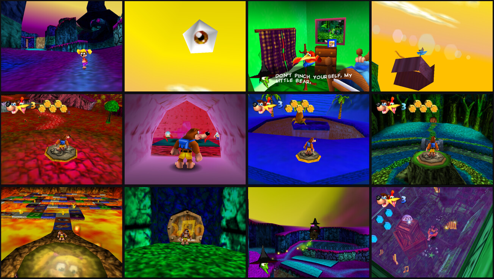

# Banjo-Kazooie: Surreal

A mod that turns Banjo-Kazooie into a dream. The game is the same game: same
levels, same jiggies, same progression. Everything around it is slightly wrong.

It's built on the [Banjo-Kazooie decompilation](https://gitlab.com/banjo.decomp/banjo-kazooie)
([GitHub mirror](https://github.com/n64decomp/banjo-kazooie)), as engine changes in
C plus scripts that rewrite the extracted assets. **No ROM or game data is in this
folder.** You build it from your own US v1.0 ROM.



## What's different

| | |
|---|---|
| **Dream palettes** | Every world is repainted: Spiral Mountain has blue cobbles and a golden house, Mumbo's Mountain is a crimson jungle, Treasure Trove Cove has mint sand and a magenta sea, Gobi's Valley is a blue desert, Freezeezy Peak has strawberry snow. Each of Click Clock Wood's seasons is the wrong season. Banjo, Kazooie and everyone they meet keep their real colours, so they look like visitors. |
| **The eye** | A giant eyeball hangs in every open sky and is always turned to look at you. |
| **Sky oddities** | Each world also has something enormous drifting around its horizon, tumbling end over end: a cuckoo clock, a fishbowl, a jiggy, a honeycomb, an egg or a Jinjo. |
| **Tumbling skies** | The sky no longer just spins. It rolls and nods, so the horizon glow ends up on a slant. |
| **Everything is jelly** | Every character, enemy, item and object squashes and stretches. The rhythm depends on where the thing stands, so crowds ripple and moving things wobble faster. Level geometry stays solid. |
| **A seasick camera** | The lens slowly breathes (40° to 46° field of view) and the horizon sways by a few degrees. |
| **Colour drift** | A slow tint cycles through the level geometry, so no place is the same colour twice. |
| **Wrong sizes** | Common enemies spawn anywhere from pocket-sized to giant, the same way on every visit. Flowers, grass tufts, music notes, eggs and feathers do too. |
| **Floaty gravity** | Falling is a slow drift (gravity −2050 instead of −2700, lower terminal velocity). Jumps hang in the air. Fall damage is unchanged. |
| *(what isn't changed)* | The title-screen demos and Bottles' bonus pictures are recordings of controller input, so they keep the original gravity and enemy sizes. With the floaty physics, Banjo fell to his death in the engine room demo and the title screen never came back. |
| **Warped tape** | Sound effects drift between about 80% and 120% of their pitch on a slow wave, with a little flutter. |
| **Wavy text** | Every line of text rides a wave. |
| **Dream logic dialog** | The opening cutscene, Bottles' first lessons and the first-meeting lines (35 conversations) are rewritten. Gruntilda now knows she's Banjo's dream. All button instructions are still accurate. |

## Status and testing

Tested in an emulator (mupen64plus, Rice video plugin), headless:

- Power-on through the logos, intro concert, title screen and every attract
  demo, back round to the Rare logo: 17,700 frames, no crash. (This test
  caught a real bug: with the floaty gravity, the recorded engine room demo
  fell to its death and the title screen never came back. Playback modes now
  use the original physics.)
- The full opening cutscene, to check the rewritten dialog and the wavy text.
- A tour of 39 maps (all nine worlds and many interiors, lair rooms, Furnace
  Fun and Gruntilda's chamber): every one loads and renders, with the
  resized-enemy count and gravity checked on screen.

A build from decomp commit `e8d31fa5` and the US v1.0 ROM produces a ROM with
SHA-1 `61a31224e91e35df2e5ac19e00142a306144a646`.

Not tested:

- **Played by a person.** The test rig has no controller, so nobody has
  actually played through a level with these changes. Floaty gravity and
  resized enemies change how the game feels and could make some jump or fight
  awkward.
- **Sound.** The pitch warp was written and compiles, but the rig has no audio
  output, so I haven't heard it.
- **Real hardware.** At its widest the lens shows about 1.4x the original
  view, and the culling region is widened to about 1.6x the area to match, so
  expect more slowdown on a console than in the original game. Emulators and
  PC ports shouldn't care.

Saves are compatible with the original game (nothing about the save format changed).

## Building it

You need the decomp's normal requirements (see its README, or
[chapter 1 of the modding guide](../banjo-kazooie-modding/01-setup-and-building.md)),
including `cargo`.

```sh
git clone https://gitlab.com/banjo.decomp/banjo-kazooie.git
cd banjo-kazooie
git checkout e8d31fa5                      # the commit surreal.patch was made against
git submodule update --init --recursive
python3 -m venv .venv && .venv/bin/python3 -m pip install -r requirements.txt
cp /path/to/your/rom.z64 baserom.us.v10.z64   # SHA-1 1fe1632098865f639e22c11b9a81ee8f29c75d7a
make                                       # must print "banjo.us.v10.z64: OK"

/path/to/banjo-kazooie-surreal/build.sh "$PWD"
# -> build/us.v10/banjo.us.v10.z64
```

`build.sh` applies `surreal.patch`, regenerates the changed assets from a
pristine copy (`assets.vanilla/`), and rebuilds. `make` then says
`baserom.us.v10.z64 differs`, which just means the result is no longer the
original game.

## How it works

| File | What it does |
|---|---|
| `surreal.patch` | All engine changes, as a diff against decomp commit `e8d31fa5`. |
| `tools/recolor.py` | Repaints models in place: CI4/CI8 palettes, RGBA16/RGBA32 texels and vertex colours. It walks each model's display list to skip vertices loaded while lighting is on, because those four bytes are normals, not colours. |
| `tools/themes.py` | The palettes: which level models get which hue rotation, saturation, tint and per-texture drift. **Edit this to repaint the game.** |
| `tools/dreamtalk.py` | Replaces spoken lines in the dialog YAML, keeping every control entry so conversations play out the same way. **Edit `DREAMS` to rewrite more dialog.** |
| `tools/bkmodel.py` | Minimal reader for the game's model format. |
| `build.sh` | Applies everything to a decomp checkout and builds. |

The engine side lives in two new files, `include/core2/surreal.h` and
`src/core2/gc/surreal.inc` (included from `sky.c`, so the linker script is
untouched), plus small hooks:

| Hook | File | Effect |
|---|---|---|
| `sky_draw` | `src/core2/gc/sky.c` | Sky tumble, the eye, the oddity |
| `gsworld_draw` | `src/core2/gsworld.c` | Camera roll and field of view for the 3D pass only, restored afterwards so the camera logic never sees them |
| `viewport_update` | `src/core1/viewport.c` | The culling frustum is hard-coded for the original lens; widened to match |
| `modelRender_draw` | `src/core2/modelRender.c` | Jelly: an extra non-uniform scale on every model matrix |
| `mapModel_opa_draw` / `_xlu_draw` | `src/core2/mapModel.c` | Colour drift; level geometry and sky opt out of jelly |
| `_printbuffer_draw_letter` | `src/core2/print.c` | Wavy text |
| actor update loop | `src/core2/code_9E370.c` | Enemy sizes, applied on an actor's first update (not at spawn, where the game mode isn't known yet) |
| `code7AF80_initCubeFromFile` | `src/core2/code_A5BC0.c` | Sprite sizes |
| `sfxsource_setSampleRate` | `src/core2/code_85800.c` | Pitch warp |
| gravity constants, `__baphysics_syncDefaults` | `src/core2/ba/physics.c` | Floaty falls, with the original values swapped back in while recorded input is playing |

Every tunable number (wobble strength, camera sway, eye size, which enemies
get resized) is in `surreal.inc` with a comment.

### Developer switches

The patch also adds a few build-time aids I used for testing. They do nothing
unless you pass them to `make`:

```sh
make TEST_MAP=0x7 TEST_EXIT=0x4                    # boot straight into a map (Treasure Trove Cove)
make TEST_MAP=0x7 TEST_PITCH=30 TEST_YAW=30        # aim the camera up and pan 30 degrees/second
make TEST_MAP=0x1 TEST_SLIDESHOW='{0x2,0x5},{0x12,0x8}' TEST_SLIDE_SECONDS=5   # tour a list of {map, exit}
```

A `TEST_MAP` build also prints a readout at the bottom of the screen: how many
enemies were resized (`R`), how many are giants (`G`) or tiny (`T`), and the
player's gravity.

`make` doesn't notice flag changes, so `touch src/core1/code_0.c src/core2/code_5C870.c src/core2/gc/sky.c`
when you change them.

## Ideas for going further

- Rewrite more dialog (there are 748 dialog files; 35 are done).
- Repaint characters too, or give each enemy type its own palette.
- Make the music follow the pitch warp (`musicSlot_setTempo` in `src/core1/code_11AC0.c`).
- More sky objects: any model in the game can be hung up there (`sSurrealSkyOddities`).
