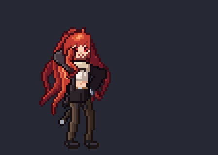

# Eris — sword draw & slash (pixel art)



- **`eris_sword_slash.aseprite`**: open directly in Aseprite. 112×80 canvas, RGBA, 16 frames with per-frame timings.
  - Layers (bottom → top): `Hair (back)`, `Back arm`, `Body`, `Head`, `Sword`, `Front arm`, `FX`
  - Tags: `Idle` (0–1, loops), `Draw Slash` (2–5), `Heavy Slash` (6–9), `Shoulder Pose + Sheathe` (10–15)
  - The palette panel holds the 56 colours used.
- `eris_sword_slash_sheet.png` + `.json`: 1× horizontal sprite sheet with Aseprite-style JSON for game engines.
- `eris_sword_slash_preview.gif`: 4× preview.

Each pixel belongs to one layer, so the stack composites to the final frame. Where a part is hidden behind
another (e.g. the blade behind her head during the wind-up), the hidden pixels aren't stored in that layer.

## Regenerating

The art is drawn by code: a hand-pixelled head sprite plus a small pose rig (IK arms and legs, procedural wavy hair,
shaded torso, sword, and smear/spark/dust effects). Keyframes are in `src/anim.py`.

```
cd src && python3 build.py ..     # needs numpy + Pillow
```
