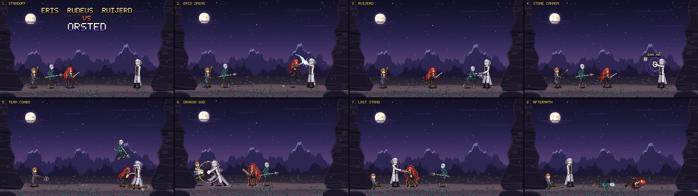

# Eris, Rudeus & Ruijerd vs Orsted — pixel-art fight animation


A 25-second pixel-art fight (480×270, 15 fps) drawn entirely by code. Eris uses the same rig and head sprites as
[`../eris-sword-slash`](../eris-sword-slash), and the other three characters were drawn to match her.
See [`PLAN.md`](PLAN.md) for the plan it was built from.

| File | What |
|---|---|
| `orsted_fight.mp4` | Full animation, 4× nearest-neighbour (1920×1080, 30 fps) |
| `orsted_fight_preview.gif` | Same, 2× (960×540) |
| `orsted_fight.aseprite` | 480×270 RGBA source: 373 frames with per-frame timings, 13 layers, 8 tags |
| `storyboard.png` | One key frame per beat |
| `src/` | The generator |



## The fight
| # | Tag | Frames | What happens |
|---|---|---|---|
| 1 | Standoff | 0–44 | Fade in, title, Orsted's eyes flare |
| 2 | Eris opens | 45–89 | Dash and leaping slash. Orsted swats the blade aside with the back of his hand; Eris flips back and skids |
| 3 | Ruijerd | 90–134 | Triple trident thrust. Orsted slips all three, seizes the shaft and throws him |
| 4 | Stone Cannon | 135–187 | Rudeus's Stone Cannon arcs over his allies; Orsted's Ran Ma ripples crumble it in mid-air |
| 5 | Team combo | 188–240 | Quagmire traps Orsted's feet, then Eris (rising cut) and Ruijerd (diving thrust) attack together. A mana burst throws them both away |
| 6 | Dragon God | 241–285 | Orsted blinks across the field (afterimages) and palm-strikes Rudeus into the cliff |
| 7 | Last stand | 286–330 | Enraged, Eris swings a full-power slash, which Orsted catches between two fingers. Ruijerd's dive gets a rising palm |
| 8 | Aftermath | 331–374 | Orsted stands alone, then fade out to the end title |

## Aseprite layers
Bottom to top: `Sky`, `Mountains`, `Cliffs`, `Ground` (static background), `Shadows`, `FX (back)`, `Rudeus`,
`Ruijerd`, `Eris`, `Orsted`, `FX`, `Text`, `Overlay` (fades and impact frames).

Every pixel above the background belongs to exactly one layer, so the stack composites to the final frame even when
characters swap depth mid-fight. Unchanged cels are stored as linked cels. Holds are merged into single longer
frames.

## Regenerating
```
cd src && python3 build.py ..      # needs numpy, Pillow and ffmpeg; about 1.5 minutes
python3 check_ase.py ../orsted_fight.aseprite   # re-reads the .aseprite and prints layers/tags
```

- `px.py`: canvas with coordinate grids and bbox-clipped primitives (capsule, disc, polygon, ring…), IK and
  shading helpers.
- `eris.py`, `rudeus.py`, `ruijerd.py`, `orsted.py`: one rig per character. Each draws into its own local canvas
  (root on the ground, facing right) from a pose of pelvis, neck, hands, feet and weapon angle. `heads.py` holds the
  hand-pixelled heads and their expressions.
- `timeline.py`: keyframe tracks. Keys are partial poses, interpolated with easing. Flags and expressions snap.
  Breathing, hair phase and wind gusts are added on top.
- `story.py`: the choreography: every key, effect event, camera shake and impact frame, beat by beat.
- `fx.py`: effects: sparks, dust, speed lines, magic circles, Stone Cannon, Ran Ma, Quagmire, shockwave, palm
  burst, afterimages, wind motes. Weapon smears come automatically from the swing between two frames
  (`common.py`).
- `stage.py`: the twilight mountain pass. `font.py`: 5×7 pixel font for the titles and callouts.
- `build.py`: rendering plus MP4, GIF, `.aseprite` and storyboard export.

Fan art of characters from *Mushoku Tensei*. All sprites, backgrounds and effects are original pixel art made for
this piece.
