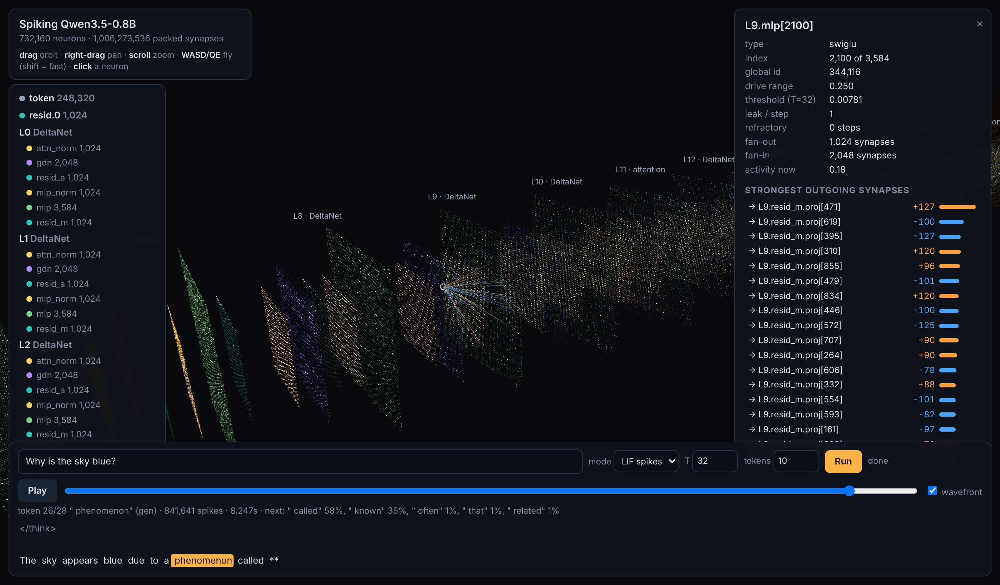

# Qwen3.5-0.8B as a spiking LIF network

This converts the text part of [Qwen/Qwen3.5-0.8B](https://huggingface.co/Qwen/Qwen3.5-0.8B) into a network of
leaky integrate-and-fire neurons, wired the way `GPU-NETWORK-GOOD/kernel.cu` wires its neurons. There are no
layers or matrices at runtime: a flat pool of neurons, each with a fan-out list of packed 32-bit synapses, and
"motor" neurons at the end whose membranes are read out as the next token.

```
732,160 neurons   748,608 dendrite slots   1,006,273,536 synapses   (3.75 GiB packed, 4.0 GB file)
```

## How it maps onto kernel.cu

| kernel.cu | here |
|---|---|
| `PackedConnection`: `dest << 8 \| int8 weight`, weight = `int8 / 127.0f` | identical packing, CSR by source neuron (`syn.offsets`, `syn.packed`) |
| `d_activations` (what `atomicAdd` writes into) | dendrite slot buffer; each slot has a gain (the int8 scale of that weight row) |
| neuron fires, pushes `sourceAct * weight` to every target, resets | `--mode graded`: exactly this, once per token |
| refractory counter (`d_refactories`, `startRefactories`) | per-neuron refractory period, counts down each timestep, membrane keeps integrating meanwhile |
| motor neurons summed into left/right/up/down | 248,320 vocab readout neurons; the biggest membrane is the next token |
| (no inputs) | 248,320 sensory token neurons; the current token's neuron fires once, its synapses are its embedding |

`--mode spike` replaces the graded push with binary spikes: each token is a window of `T` timesteps, the neuron's
drive arrives as a constant current of `drive / T` per step, and every spiking neuron runs

```
v = leak * v + drive / T
if not refractory:  v >= +theta/2  ->  spike +1      v <= -theta/2  ->  spike -1
                    (a membrane past several thresholds fires that many spikes at once: a burst)
v -= spikes * theta                      # reset by subtraction
each spike pushes  theta * (int8 / 127) * gain  into every target slot
```

`theta = range / T`, where `range` is the neuron's calibrated drive range (stored in the file). Drives inside the
range give at most one spike per timestep; the rare drive beyond it (LLM activations are heavy-tailed: 0.3% of
drives carry about a fifth of the signal in the MLP and DeltaNet neurons) comes out as bursts instead of being
clipped. `max_burst=1` in `Engine` forbids bursts if you want strictly one spike per step.

`test_kernel_style.py` takes real spike payloads and pushes them through the packed synapses exactly the way
`propagateKernel` does (loop over firing neurons, unpack dest and weight, accumulate); the currents match the
engine's batched path to ~1e-7.

## The neurons

Populations are contiguous index ranges; a population's type says what its neurons compute from their dendrites.

| type | count | what it does |
|---|---|---|
| `token` | 248,320 | sensory; fires once when its token is the input |
| `integrator` | 49 × 1,024 | residual stream: membrane = sum of everything that arrived (analog, passes its value on) |
| `rmsnorm` | 49 × 1,024 | LIF; drive = input divided by the population's RMS (divisive normalisation) × gain |
| `swiglu` | 24 × 3,584 | LIF with two dendrites; drive = silu(gate) × up |
| `gdn` | 18 × 2,048 | LIF outputs of a Gated DeltaNet block (below) |
| `attention` | 6 × 2,048 | LIF outputs of a softmax attention block with a key/value ring buffer |
| `readout` | 248,320 | motor neurons; membrane = logit |

Every weight matrix of the model is a set of synapses leaving a spiking population, so all of the 1.0B synapses
carry spikes in `--mode spike` (the only graded pushes left are the identity links of the residual stream).

### Where the recurrence is

Within one token the signal goes one way, token neurons → 24 blocks → readout. Memory from token to token lives in:

* **Fast plastic synapses** (18 `gdn` blocks): each of 16 heads has a 128×128 synapse matrix `S` that decays
  every token and is rewritten by a delta rule, `S ← S·decay + k ⊗ β(v − Sᵀk)`. The next token reads it.
* **Delay lines**: the `gdn` input dendrites have 4 taps (this token and the 3 before).
* **Ring buffer** (6 `attention` blocks): keys and values of the last `window` tokens (8192 by default), so the
  whole state is fixed-size.
* Optionally the membranes themselves (`carry_membrane=True` keeps each neuron's leftover potential, leaked,
  into the next window).

During generation the chosen output token is fed back into the token neurons.

## Results

RESULTS_PLACEHOLDER

## Running it

Needs Python 3.10+ (`transformers` is only used for the tokenizer, conversion and verification):

```bash
pip install torch numpy safetensors transformers jinja2 huggingface_hub
```

On Windows with an NVIDIA GPU, install the CUDA build of torch from pytorch.org first.

```bash
# 1. get the model (1.75 GB)
hf download Qwen/Qwen3.5-0.8B --local-dir Qwen3.5-0.8B

# 2. convert (writes the 4 GB .snn, then calibrates thresholds on data/calibration_chats.json; ~4 min on CPU)
python convert.py --model Qwen3.5-0.8B --out qwen3.5-0.8b.snn

# 3. talk to it
python chat.py --snn qwen3.5-0.8b.snn                        # binary LIF spikes, T=32
python chat.py --snn qwen3.5-0.8b.snn --mode graded          # kernel.cu-style graded spikes
python chat.py --snn qwen3.5-0.8b.snn --T 64 --leak 0.999 --refractory 1
python chat.py --snn qwen3.5-0.8b.snn --device cuda          # on an NVIDIA GPU (fp16 synapses)

# 4. measure it against the original model
python verify.py --snn qwen3.5-0.8b.snn --model Qwen3.5-0.8B --text some.txt other.txt --T 16 32 64
python test_kernel_style.py --snn qwen3.5-0.8b.snn
```

`convert.py --leak/--refractory` store per-neuron defaults in the file; `chat.py --leak/--refractory` override
them at runtime. `data/calibration_chats.json` was written by the original model (`make_calibration.py`).

## Looking at it

```bash
python viewer.py --snn qwen3.5-0.8b.snn        # then open http://127.0.0.1:8765
```



Every one of the 732,160 neurons is a point. Populations are sheets in processing order: token neurons on the
left, the 24 blocks, the vocab readout on the right (colour = neuron type, see the list on the left; click a name
to fly there).

* **drag** orbits, **right-drag** pans, **scroll** zooms, **WASD / Q E** fly (hold shift to go fast)
* **click a neuron**: its parameters (type, drive range, threshold, leak, refractory, fan-in/out) and its strongest
  outgoing and incoming synapses, decoded live from the packed `dest << 8 | int8` words in the `.snn` file and drawn
  as lines (orange = positive weight, blue = negative). Click a synapse to follow it to the next neuron.
* **Run** a prompt: the network processes it token by token. Each token lights up the neurons by how much they fired
  in that window (spiking neurons: spikes relative to their maximum; residual stream: membrane relative to the
  population's largest), with a wavefront sweeping in the order the populations compute. The slider and the token
  strip replay any token; the panel shows spikes per token and the readout's top predictions.

The page uses three.js from jsdelivr, so it needs internet the first time; the server only reads the `.snn` file
(the engine is loaded on the first Run).

## Files

* `snn_format.py` – the `.snn` file: JSON header, neuron arrays, packed synapses
* `convert.py` – safetensors → `.snn`, plus threshold calibration
* `engine.py` – runs a `.snn` file; knows nothing about transformers
* `chat.py` – chat / generation
* `verify.py` – compares against the original model
* `test_kernel_style.py` – kernel.cu-style event propagation equals the engine's
* `make_calibration.py` – regenerates the calibration chats
* `viewer.py`, `viewer/index.html` – the 3D viewer
