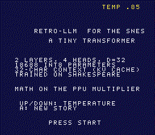
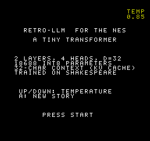

# retro-llm: a tiny transformer LLM on the NES, SNES and N64

 

A real (if very small) GPT-style language model: a 2-layer, 4-head, character-level
transformer with a KV cache. It was trained on Shakespeare and runs entirely on the
console CPU, with integer math only. The same 18,688 int8 weights run on all three
machines, and each one produces **bit-for-bit the same text** as the Python reference
for the same random seed.

| ROM | CPU | how it multiplies | speed |
|-----|-----|-------------------|-------|
| `roms/retro-llm.nes` | Ricoh 2A03 (6502) @ 1.79 MHz | quarter-square tables + a self-modifying inner loop in RAM | ~1.2 chars/s |
| `roms/retro-llm.sfc` | 65816 @ 3.58 MHz (FastROM) | the PPU's signed 16×8 Mode 7 multiplier (`$211B`/`$211C`) | ~2.4 chars/s |
| `roms/retro-llm.z64` | VR4300 (MIPS III) @ 93.75 MHz | `mult` (plain C) | hundreds/s (display is throttled to 40 chars/s) |

Controls (all three): **Start** begins (the N64 also starts by itself after 3 s),
**Up/Down** change the sampling temperature, **A** starts a new story.

## The model

| | |
|---|---|
| vocabulary | 36 characters: `A-Z`, space, newline, `!',-.:;?` |
| layers × heads | 2 × 4 (head dim 8), model width 32, MLP width 64 (ReLU) |
| context | 32 characters, ring-buffer KV cache |
| positions | ALiBi (per-head distance penalties 0, 1, 2, 6), so the cache can slide forever |
| parameters | 18,688, all int8 (18.3 KB of ROM) |
| quality | ~2.0 nats/char on held-out Shakespeare (integer engine, sliding window) |

Sample (from `train/ref.py`, which is identical to what the consoles print for that seed):

```
LOOD FROWSUE AND YOU BECIED MY PIGHT THAT AND BOTH THOLY HERE IT VING THY, THUSSO PREE FREOD;
GRE YOUR NEIND:
AY HAVER:
BUT IT LOSE PLEATH AND AGRORD YOUR-RUTER IN BEITUR THER TO AREATS MUEE.
```

It learned spelling-ish words, line structure, `NAME:` speaker headers and punctuation.
18K parameters only gets you so far.

### Integer-only inference (the spec all three consoles implement)

`train/ref.py` is the source of truth; `train/spec.py` holds the constants.

* Activations are int8 in [-127, 127]. Every matrix is int8 with a power-of-two scale, so
  `y = clamp8((x·W + 2^(s-1)) >> s)`. Accumulators are 24/32-bit. There are no biases and no LayerNorm;
  the residual stream just saturates.
* Attention scores are `(q·k + 64) >> 7` minus the ALiBi penalty. Softmax uses a 256-entry
  `exp` table: `e = EXP[min(max - score, 255)]`, `p = min(127, (e << 7) / Σe)`.
  The output is `(Σ p·v + 64) >> 7`.
* Sampling uses the logits through a temperature `exp` table, then a draw with a 16-bit
  xorshift RNG (7, 9, 8) using rejection sampling over a power-of-two mask.

Training (`train/train.py`) is quantization-aware: the PyTorch forward pass performs exactly
this integer arithmetic, with straight-through estimators for the rounding. The trained
network therefore *is* the integer network. `ref.py --check` confirms 0 mismatching logits
between PyTorch and the integer reference.

## Verification

The ROMs log every generated token, the seed and the temperature to RAM.
`tools/check_rom.py` runs a ROM headless in a real emulator core through a small ctypes
libretro frontend (`tools/retro.py`). It presses Start, lets the ROM run for a minute
of emulated time, reads the log back, and replays `ref.py` with the same seed:

```
[nes]  ... tokens=72  -> 1.20 tokens/s   bit-exact: True (72 tokens compared)
[snes] ... tokens=146 -> 2.43 tokens/s   bit-exact: True (146 tokens compared)
engine.c on x86-64: bit-exact over 300 tokens
engine.c on mips-be (qemu): bit-exact over 300 tokens
```

* **NES**: verified in Nestopia (libretro); it also boots and runs in ares.
* **SNES**: verified in Snes9x (libretro).
* **N64**: the C inference engine is verified bit-exact when compiled for big-endian MIPS
  and run under `qemu-mips`. **The N64 ROM itself has not been booted in an emulator here.**
  Ubuntu's ares build has no N64 core, and its mupen64plus (2.5.9) predates libdragon's
  IPL3. Try a current ares, Gopher64 or a flash cart. If the emulator has an IS-Viewer
  (ares, current mupen64plus), the ROM also prints its seed and the generated text to the
  emulator log.

A bug that this caught: on the SNES, the BG1 scroll registers (`$210D/$210E`) share the
Mode 7 write latch with the multiplier's 16-bit operand register `$211B`. If the vblank NMI
updated the BG1 scroll between the two `$211B` writes, one row of a matrix multiply was
silently wrong. That showed up as a single divergent token about 25 characters in. The text
now scrolls on BG2.

## Console notes

**NES** (`nes/llm.s`, ca65): mapper 1 (MMC1) with 8 KB battery WRAM at `$6000` holding
the 4 KB KV cache, because the console only has 2 KB of RAM. The weights fill the switchable
16 KB bank exactly; code, tables and embeddings live in the fixed bank.
`a·b = f(a+b) - f(b-a)` with `f(n) = n²/4` is looked up from 1 KB of tables. The four table
operands and the weight-row address are patched into a 50-byte inner loop in RAM
(~70 cycles per multiply-accumulate). Products get a +$8000 bias so they can be accumulated
unsigned, and rows whose input is 0 (half the MLP after ReLU) are skipped. Output scrolls
with the hardware vertical scroll; the temperature indicator is drawn with sprites.

**SNES** (`snes/llm.s`, ca65 65816 mode): LoROM/FastROM, 32 KB. All state sits in the
first 8 KB of WRAM. Each input element is written once to the 16-bit multiplicand register.
Each weight is then a single 8-bit write to `$211C` followed by a 16-bit read of `$2134`.

**N64** (`n64/`, C): no SDK. The ROM is built with Ubuntu's `mips-linux-gnu-gcc`
(`-march=vr4300 -mabi=32`), a 15-line `crt0.S`, and libdragon's public-domain open-source
IPL3 (`ipl3_compat.z64`, vendored). `main.c` programs the VI for a 320×240 16-bit framebuffer,
draws the same 8×8 font, reads controller 1 through the PIF, and shows the measured
tokens/second.

## Rebuilding

```
# Ubuntu 24.04
sudo apt install cc65 gcc-mips-linux-gnu qemu-user libretro-nestopia libretro-snes9x
pip install torch numpy pillow

cd train && python3 train.py --steps 80000 --float-steps 10000 --bs 256   # ~65 min on 4 CPU cores
python3 ref.py --check                  # PyTorch == integer reference, sample text
cd .. && python3 build_all.py --verify  # build the 3 ROMs, check NES/SNES in emulators
python3 tools/make_gif.py snes          # record a GIF
```

`build/model.pt` is committed, so `build_all.py` works without retraining.
`train.py` downloads Tiny Shakespeare (public domain) into `data/` on first run.
