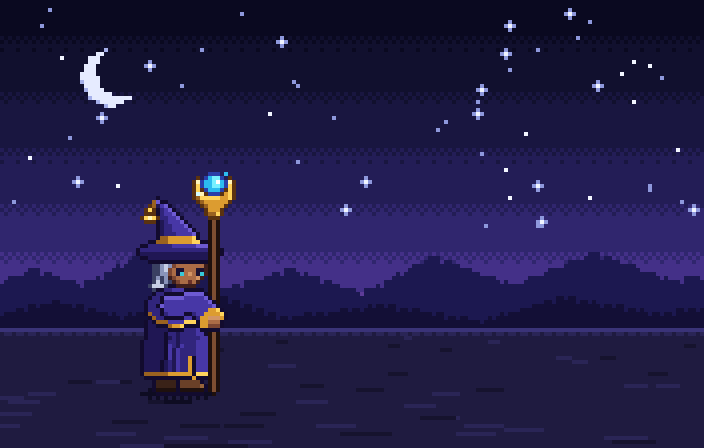

# Star-caller mage — "Starfall" special (pixel art)



An original character: a star-caller in a bent indigo hat with a silver braid and a crescent-headed staff.
The special runs in five beats:

1. **Gather**: a tap of the staff wakes a summoning circle under the mage's feet.
2. **Charge**: the mage lifts off the ground, light streams into the staff orb, a constellation draws itself
   and closes into a second circle in the sky, and a target sigil locks onto the ground.
3. **Hush**: the scene goes dark, the orb implodes and a hairline of light drops from the sky.
4. **Starfall**: an impact frame, then a pillar of light with shockwaves, lightning, debris, dust and screen
   shake, followed by a shower of falling stars.
5. **Settle**: the crater cools, smoke and embers drift off, and the staff comes back to rest.

## Files

- **`starfall_mage.aseprite`**: open directly in Aseprite. 176×112 canvas, RGBA, 52 frames with per-frame timings.
  - Layers (bottom → top): `Background`, `FX (back)`, `Braid + lining`, `Back arm`, `Body`, `Head + hat`,
    `Staff`, `Front arm`, `FX (front)`. Hide `Background` to get the sprite and effects on transparency.
  - Tags: `Idle` (0–3, loops), `Gather` (4–9), `Charge` (10–24), `Starfall` (25–43), `Settle` (44–51)
  - The palette panel holds the 135 colours used. Screen shake is baked into the frames.
- `starfall_mage_sheet.png` + `.json`: 1× sprite sheet (8 columns) with Aseprite-style JSON for game engines.
- `starfall_mage_preview.gif`: 4× preview.

## Regenerating

The art is drawn by code. `src/mage.py` is the character rig (a hand-pixelled head plus a posed cloak, hat,
arms and staff), `src/backdrop.py` the night plain, `src/fx.py` the effect primitives, and `src/anim.py`
the timeline that decides the pose and effects of every frame.

```
cd src && python3 build.py ..     # needs numpy + Pillow
```
